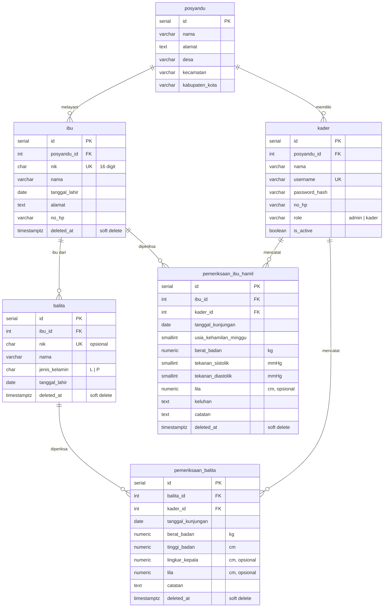

# ERD & Kamus Data — Database Posyandu

Database: **PostgreSQL 16** (kompatibel ≥ 13). Konvensi penamaan: `snake_case`, nama tabel/kolom dalam Bahasa Indonesia, tabel berbentuk tunggal.

> DDL di §4 sudah diuji di PostgreSQL 16 (termasuk seluruh constraint) dan lolos parser impor dbdiagram (`@dbml/cli sql2dbml --postgres`). Gunakan sebagai isi `database/schema.sql`.

## 1. Diagram

Versi gambar: [`assets/erd.png`](assets/erd.png). Untuk tugas tetap dipakai link dbdiagram (§7).



Semua tabel juga memiliki `created_at` dan `updated_at` (`TIMESTAMPTZ`, default `NOW()`); kolom ini tidak digambar agar diagram ringkas.

## 2. Relasi

| Relasi | Kardinalitas | On delete | Keterangan |
|---|---|---|---|
| posyandu → kader | 1 : N | RESTRICT | Setiap akun terikat ke satu posyandu |
| posyandu → ibu | 1 : N | RESTRICT | Balita mewarisi posyandu dari ibunya |
| ibu → balita | 1 : N | RESTRICT | Satu ibu dapat memiliki beberapa balita |
| ibu → pemeriksaan_ibu_hamil | 1 : N | RESTRICT | Riwayat kunjungan kehamilan |
| balita → pemeriksaan_balita | 1 : N | RESTRICT | Riwayat tumbuh kembang |
| kader → pemeriksaan_* | 1 : N | RESTRICT | Kader pencatat (diisi otomatis dari token) |

Semua FK memakai `RESTRICT` karena penghapusan dilakukan dengan *soft delete* (`deleted_at`), bukan `DELETE` fisik. Lihat [ADR-003](06-decisions.md).

## 3. Kamus data

Legenda: **W** = wajib (NOT NULL), **U** = unik, **D** = default.

### `posyandu`
| Kolom | Tipe | | Keterangan |
|---|---|---|---|
| id | SERIAL | PK | |
| nama | VARCHAR(100) | W | Mis. "Posyandu Melati" |
| alamat | TEXT | | |
| desa, kecamatan, kabupaten_kota | VARCHAR(100) | | |

Fase 1 hanya berisi satu baris (dari seed). Lihat [ADR-002](06-decisions.md).

### `kader`
| Kolom | Tipe | | Keterangan |
|---|---|---|---|
| id | SERIAL | PK | |
| posyandu_id | INTEGER | W, FK | |
| nama | VARCHAR(100) | W | |
| username | VARCHAR(30) | W, U | Huruf kecil, angka, `_`; 3–30 karakter |
| password_hash | VARCHAR(255) | W | Hash bcrypt. **Tidak pernah dikirim di respons API** |
| no_hp | VARCHAR(15) | | |
| role | VARCHAR(10) | W, D `'kader'` | `CHECK IN ('admin','kader')` |
| is_active | BOOLEAN | W, D `TRUE` | `false` = dinonaktifkan (pengganti hapus akun) |

### `ibu`
| Kolom | Tipe | | Keterangan |
|---|---|---|---|
| id | SERIAL | PK | |
| posyandu_id | INTEGER | W, FK | Diisi otomatis dari token |
| nik | CHAR(16) | W, U* | `CHECK` 16 digit angka |
| nama | VARCHAR(100) | W | |
| tanggal_lahir | DATE | W | |
| alamat | TEXT | W | |
| no_hp | VARCHAR(15) | | |
| deleted_at | TIMESTAMPTZ | | `NULL` = aktif |

### `balita`
| Kolom | Tipe | | Keterangan |
|---|---|---|---|
| id | SERIAL | PK | |
| ibu_id | INTEGER | W, FK | Ibu harus aktif dan satu posyandu |
| nik | CHAR(16) | U* | Opsional (bayi baru lahir sering belum punya NIK) |
| nama | VARCHAR(100) | W | |
| jenis_kelamin | CHAR(1) | W | `'L'` / `'P'` |
| tanggal_lahir | DATE | W | |
| deleted_at | TIMESTAMPTZ | | |

### `pemeriksaan_balita`
| Kolom | Tipe | | Keterangan |
|---|---|---|---|
| id | SERIAL | PK | |
| balita_id | INTEGER | W, FK | |
| kader_id | INTEGER | W, FK | Pencatat; dari token, bukan body |
| tanggal_kunjungan | DATE | W | U* bersama `balita_id` |
| berat_badan | NUMERIC(4,2) | W | kg |
| tinggi_badan | NUMERIC(4,1) | W | cm (panjang badan untuk bayi) |
| lingkar_kepala | NUMERIC(4,1) | | cm |
| lila | NUMERIC(4,1) | | Lingkar lengan atas, cm |
| catatan | TEXT | | Maks. 500 karakter (divalidasi di API) |
| deleted_at | TIMESTAMPTZ | | |

### `pemeriksaan_ibu_hamil`
| Kolom | Tipe | | Keterangan |
|---|---|---|---|
| id | SERIAL | PK | |
| ibu_id | INTEGER | W, FK | |
| kader_id | INTEGER | W, FK | Pencatat; dari token |
| tanggal_kunjungan | DATE | W | U* bersama `ibu_id` |
| usia_kehamilan_minggu | SMALLINT | W | |
| berat_badan | NUMERIC(5,2) | W | kg |
| tekanan_sistolik | SMALLINT | W | mmHg |
| tekanan_diastolik | SMALLINT | W | mmHg |
| lila | NUMERIC(4,1) | | cm |
| keluhan | TEXT | | Maks. 500 karakter |
| catatan | TEXT | | Maks. 500 karakter |
| deleted_at | TIMESTAMPTZ | | |

\* **U\*** = unik hanya di antara baris aktif (*partial unique index* `WHERE deleted_at IS NULL`). Data yang sudah di-soft-delete tidak menghalangi input ulang.

## 4. DDL referensi (`database/schema.sql`)

```sql
-- =====================================================================
-- Sistem Monitoring Kesehatan Ibu & Anak (Posyandu) — skema PostgreSQL
-- =====================================================================

CREATE TABLE posyandu (
  id              SERIAL PRIMARY KEY,
  nama            VARCHAR(100) NOT NULL,
  alamat          TEXT,
  desa            VARCHAR(100),
  kecamatan       VARCHAR(100),
  kabupaten_kota  VARCHAR(100),
  created_at      TIMESTAMPTZ NOT NULL DEFAULT NOW(),
  updated_at      TIMESTAMPTZ NOT NULL DEFAULT NOW()
);

CREATE TABLE kader (
  id              SERIAL PRIMARY KEY,
  posyandu_id     INTEGER NOT NULL REFERENCES posyandu(id) ON DELETE RESTRICT,
  nama            VARCHAR(100) NOT NULL,
  username        VARCHAR(30) NOT NULL UNIQUE,
  password_hash   VARCHAR(255) NOT NULL,
  no_hp           VARCHAR(15),
  role            VARCHAR(10) NOT NULL DEFAULT 'kader',
  is_active       BOOLEAN NOT NULL DEFAULT TRUE,
  created_at      TIMESTAMPTZ NOT NULL DEFAULT NOW(),
  updated_at      TIMESTAMPTZ NOT NULL DEFAULT NOW(),
  CONSTRAINT chk_kader_role CHECK (role IN ('admin', 'kader'))
);

CREATE TABLE ibu (
  id              SERIAL PRIMARY KEY,
  posyandu_id     INTEGER NOT NULL REFERENCES posyandu(id) ON DELETE RESTRICT,
  nik             CHAR(16) NOT NULL,
  nama            VARCHAR(100) NOT NULL,
  tanggal_lahir   DATE NOT NULL,
  alamat          TEXT NOT NULL,
  no_hp           VARCHAR(15),
  created_at      TIMESTAMPTZ NOT NULL DEFAULT NOW(),
  updated_at      TIMESTAMPTZ NOT NULL DEFAULT NOW(),
  deleted_at      TIMESTAMPTZ,
  CONSTRAINT chk_ibu_nik CHECK (nik ~ '^[0-9]{16}$')
);

CREATE TABLE balita (
  id              SERIAL PRIMARY KEY,
  ibu_id          INTEGER NOT NULL REFERENCES ibu(id) ON DELETE RESTRICT,
  nik             CHAR(16),
  nama            VARCHAR(100) NOT NULL,
  jenis_kelamin   CHAR(1) NOT NULL,
  tanggal_lahir   DATE NOT NULL,
  created_at      TIMESTAMPTZ NOT NULL DEFAULT NOW(),
  updated_at      TIMESTAMPTZ NOT NULL DEFAULT NOW(),
  deleted_at      TIMESTAMPTZ,
  CONSTRAINT chk_balita_nik CHECK (nik IS NULL OR nik ~ '^[0-9]{16}$'),
  CONSTRAINT chk_balita_jk  CHECK (jenis_kelamin IN ('L', 'P'))
);

CREATE TABLE pemeriksaan_balita (
  id                 SERIAL PRIMARY KEY,
  balita_id          INTEGER NOT NULL REFERENCES balita(id) ON DELETE RESTRICT,
  kader_id           INTEGER NOT NULL REFERENCES kader(id) ON DELETE RESTRICT,
  tanggal_kunjungan  DATE NOT NULL,
  berat_badan        NUMERIC(4,2) NOT NULL,
  tinggi_badan       NUMERIC(4,1) NOT NULL,
  lingkar_kepala     NUMERIC(4,1),
  lila               NUMERIC(4,1),
  catatan            TEXT,
  created_at         TIMESTAMPTZ NOT NULL DEFAULT NOW(),
  updated_at         TIMESTAMPTZ NOT NULL DEFAULT NOW(),
  deleted_at         TIMESTAMPTZ,
  CONSTRAINT chk_pb_bb   CHECK (berat_badan BETWEEN 0.5 AND 40),
  CONSTRAINT chk_pb_tb   CHECK (tinggi_badan BETWEEN 30 AND 130),
  CONSTRAINT chk_pb_lk   CHECK (lingkar_kepala IS NULL OR lingkar_kepala BETWEEN 25 AND 60),
  CONSTRAINT chk_pb_lila CHECK (lila IS NULL OR lila BETWEEN 5 AND 30)
);

CREATE TABLE pemeriksaan_ibu_hamil (
  id                     SERIAL PRIMARY KEY,
  ibu_id                 INTEGER NOT NULL REFERENCES ibu(id) ON DELETE RESTRICT,
  kader_id               INTEGER NOT NULL REFERENCES kader(id) ON DELETE RESTRICT,
  tanggal_kunjungan      DATE NOT NULL,
  usia_kehamilan_minggu  SMALLINT NOT NULL,
  berat_badan            NUMERIC(5,2) NOT NULL,
  tekanan_sistolik       SMALLINT NOT NULL,
  tekanan_diastolik      SMALLINT NOT NULL,
  lila                   NUMERIC(4,1),
  keluhan                TEXT,
  catatan                TEXT,
  created_at             TIMESTAMPTZ NOT NULL DEFAULT NOW(),
  updated_at             TIMESTAMPTZ NOT NULL DEFAULT NOW(),
  deleted_at             TIMESTAMPTZ,
  CONSTRAINT chk_pih_usia  CHECK (usia_kehamilan_minggu BETWEEN 1 AND 45),
  CONSTRAINT chk_pih_bb    CHECK (berat_badan BETWEEN 30 AND 200),
  CONSTRAINT chk_pih_sis   CHECK (tekanan_sistolik BETWEEN 60 AND 250),
  CONSTRAINT chk_pih_dia   CHECK (tekanan_diastolik BETWEEN 30 AND 150),
  CONSTRAINT chk_pih_td    CHECK (tekanan_diastolik < tekanan_sistolik),
  CONSTRAINT chk_pih_lila  CHECK (lila IS NULL OR lila BETWEEN 10 AND 60)
);

-- Keunikan hanya berlaku untuk data aktif (belum di-soft-delete)
CREATE UNIQUE INDEX uq_ibu_nik_aktif    ON ibu (nik) WHERE deleted_at IS NULL;
CREATE UNIQUE INDEX uq_balita_nik_aktif ON balita (nik) WHERE deleted_at IS NULL AND nik IS NOT NULL;
CREATE UNIQUE INDEX uq_pb_per_tanggal   ON pemeriksaan_balita (balita_id, tanggal_kunjungan) WHERE deleted_at IS NULL;
CREATE UNIQUE INDEX uq_pih_per_tanggal  ON pemeriksaan_ibu_hamil (ibu_id, tanggal_kunjungan) WHERE deleted_at IS NULL;

-- Indeks pencarian, riwayat, dan rekap
CREATE INDEX idx_kader_posyandu   ON kader (posyandu_id);
CREATE INDEX idx_ibu_posyandu     ON ibu (posyandu_id, nama);
CREATE INDEX idx_balita_ibu       ON balita (ibu_id);
CREATE INDEX idx_pb_tanggal       ON pemeriksaan_balita (tanggal_kunjungan);
CREATE INDEX idx_pb_kader         ON pemeriksaan_balita (kader_id);
CREATE INDEX idx_pih_tanggal      ON pemeriksaan_ibu_hamil (tanggal_kunjungan);
CREATE INDEX idx_pih_kader        ON pemeriksaan_ibu_hamil (kader_id);
```

## 5. Aturan validasi

Aturan ditegakkan di **dua lapis**:

1. **API (zod):** memberi pesan per kolom dalam Bahasa Indonesia, status 400.
2. **Database (CHECK/UNIQUE/FK):** jaring pengaman terakhir. Pelanggaran yang lolos dari API dipetakan ke 400/409 oleh error handler ([Architecture §Error](03-architecture.md#8-penanganan-error)).

| Field | Aturan | Lapis |
|---|---|---|
| `nik` | Tepat 16 digit angka | API + DB |
| `nik` | Unik di antara data aktif → 409 | DB (+ cek di service untuk pesan yang jelas) |
| `nama` | 2–100 karakter, di-*trim* | API |
| `no_hp` | Opsional; `^(\+62\|62\|0)8[0-9]{7,12}$`, disimpan apa adanya | API |
| `ibu.tanggal_lahir` | Usia 10–60 tahun pada hari ini | API |
| `balita.tanggal_lahir` | Tidak di masa depan; usia < 60 bulan saat didaftarkan | API |
| `jenis_kelamin` | `L` atau `P` | API + DB |
| `tanggal_kunjungan` | Format `YYYY-MM-DD`; tidak di masa depan (WIB); tidak sebelum tanggal lahir peserta | API + service |
| `tanggal_kunjungan` (balita) | Usia balita pada tanggal itu < 60 bulan | service |
| `tanggal_kunjungan` | Satu pemeriksaan per peserta per tanggal → 409 | DB |
| `berat_badan` (balita) | 0,5–40 kg, maks. 2 desimal | API + DB |
| `tinggi_badan` (balita) | 30–130 cm, maks. 1 desimal | API + DB |
| `lingkar_kepala` | Opsional; 25–60 cm | API + DB |
| `lila` (balita) | Opsional; 5–30 cm | API + DB |
| `usia_kehamilan_minggu` | Bilangan bulat 1–45 | API + DB |
| `berat_badan` (ibu) | 30–200 kg | API + DB |
| `tekanan_sistolik` | Bilangan bulat 60–250 | API + DB |
| `tekanan_diastolik` | Bilangan bulat 30–150 dan < sistolik | API + DB |
| `lila` (ibu) | Opsional; 10–60 cm | API + DB |
| `catatan`, `keluhan` | Opsional; maks. 500 karakter | API |
| `username` | `^[a-z0-9_]{3,30}$` | API |
| `password` | Minimal 8 karakter | API |

> Rentang di atas adalah **batas kewajaran input** untuk mencegah salah ketik (mis. 92,5 kg untuk balita), bukan ambang klinis. Lihat PRD §9.

## 6. Seed (`database/seed.sql`)

Isi minimal:

1. Satu baris `posyandu` (nama dan alamat posyandu sasaran).
2. Satu akun `admin` dengan `password_hash` bcrypt dari password awal. Password awal dicatat di README dan **wajib diganti** setelah login pertama (`PATCH /api/auth/password`).
3. (Opsional, untuk demo/Postman) 1 akun `kader`, 2–3 ibu, 2–3 balita, dan beberapa pemeriksaan di dua bulan berbeda agar riwayat, filter tanggal, dan rekap bisa didemokan. Gunakan NIK fiktif yang jelas palsu (mis. diawali `9999`).

Hash bcrypt dibuat sekali dengan Node (`bcryptjs.hashSync('<password>', 10)`) lalu ditempel ke `seed.sql`. Gunakan `INSERT ... ON CONFLICT DO NOTHING` atau jalankan seed hanya pada database kosong.

## 7. Import ke dbdiagram

1. Buka dbdiagram.io → **Import** → **From PostgreSQL**.
2. Tempel isi `schema.sql` (cukup DDL; `seed.sql` tidak perlu).
3. Simpan, lalu **Share** → *Anyone with the link can view*. Masukkan link ke laporan tugas.

Catatan: dbdiagram menampilkan *partial unique index* sebagai unique biasa dan tidak menggambar `CHECK` constraint. Ini normal; definisi lengkapnya tetap di `schema.sql`.

Jangan menaruh `CREATE FUNCTION`/`TRIGGER` di `schema.sql` karena dapat menggagalkan impor dbdiagram. `updated_at` diisi oleh aplikasi (`SET updated_at = NOW()` di setiap query UPDATE).

## 8. Perkembangan skema yang sudah diantisipasi

| Kebutuhan masa depan | Rencana perubahan |
|---|---|
| Multi-posyandu | Tambah data `posyandu`; semua query sudah difilter `posyandu_id`. Tambah endpoint kelola posyandu (role super-admin). |
| Imunisasi | Tabel `jenis_imunisasi` + `imunisasi_balita (balita_id, jenis_imunisasi_id, tanggal, kader_id)` |
| Jadwal posyandu | Tabel `jadwal_posyandu (posyandu_id, tanggal, jam_mulai, lokasi, keterangan)` |
| Episode kehamilan | Tabel `kehamilan (ibu_id, hpht, taksiran_persalinan, status)`; `pemeriksaan_ibu_hamil.kehamilan_id` |
| Status gizi WHO | Tabel acuan z-score; dihitung dari BB, TB, usia, dan jenis kelamin yang sudah tersimpan |
| Akun ibu | Tabel `pengguna_ibu` atau kolom akun di `ibu` |
| Audit perubahan | Kolom `updated_by` atau tabel `audit_log` |
| Migrasi terkelola | Beralih dari `schema.sql` tunggal ke tool migrasi (mis. `node-pg-migrate`) setelah tugas dikumpulkan |
